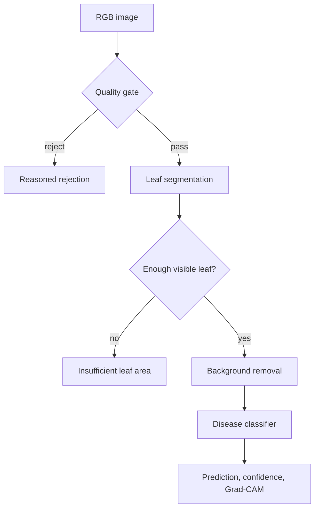
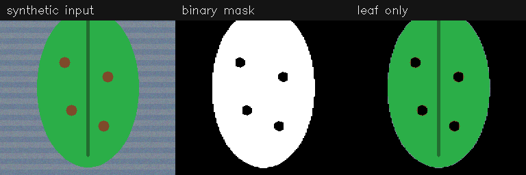

# Basil CV System

[](https://github.com/Alborzsfe/basil-cv-system/actions/workflows/ci.yml)
[](https://www.python.org/)
[](LICENSE)

A reproducible PyTorch pipeline for basil leaf semantic segmentation,
background removal, disease classification, uncertainty handling, and Grad-CAM.

> **Evidence status:** the software path is implemented and tested, but this
> repository contains no greenhouse dataset, verified disease labels, or trained
> checkpoints. It therefore makes **no real-world accuracy or biological claim**.
> The committed result is a deterministic synthetic smoke test only.

## Pipeline



The first version treats all visible leaf pixels as one foreground class. It is
semantic segmentation, not individual-leaf instance segmentation.

## What is implemented

- dataset scaffolding and strict image/mask validation;
- plant/session group-aware train/validation/test splits with leakage checks;
- paired segmentation and multi-mode classification datasets;
- U-Net with ResNet-18/34 encoders plus tiny models for fast tests;
- Dice, BCE, focal, cross-entropy, class weighting, and weighted sampling;
- training, early stopping, safe checkpoint loading, held-out evaluation, and manifests;
- black, gray, or blurred background replacement and mask cleanup;
- quality-gated end-to-end inference with an explicit `unknown` outcome;
- Grad-CAM and auditable raw-vs-leaf-only experiment comparison;
- packaging, CI, tests, documentation, and a deterministic synthetic smoke test.

## Evidence at a glance

| Item | Available? | Meaning |
| --- | --- | --- |
| Executable end-to-end software path | Yes | Verified locally and in CI |
| Synthetic pipeline artifact | Yes | Functional wiring only |
| Real greenhouse images or labels | No | Must be supplied and documented |
| Trained production checkpoints | No | Training is intentionally data-dependent |
| Segmentation/classification metrics | No | Cannot be claimed before held-out evaluation |



The synthetic artifact uses deterministic rules and synthetic class names. See
[Results](docs/RESULTS.md) for its exact scope.

## Quick start

Python 3.10–3.12 is supported. This CPU setup avoids accidentally installing a
CUDA wheel on a machine that does not need one:

```bash
python -m venv .venv
source .venv/bin/activate
python -m pip install --upgrade pip
python -m pip install --index-url https://download.pytorch.org/whl/cpu "torch>=2.3,<3" "torchvision>=0.18,<1"
python -m pip install -e ".[dev]"

ruff check .
pytest --cov=src --cov-report=term-missing --cov-fail-under=70
python scripts/run_smoke_demo.py
```

For a CUDA environment, install the appropriate PyTorch build for that system,
then run `python -m pip install -e ".[dev]"`.

## Data contracts

Segmentation uses paired files with matching stems and metadata containing at
least:

```text
image_filename,mask_filename,plant_id,duct_id,hole_id,capture_session_id,timestamp
```

Classification metadata contains:

```text
image_path,label,plant_id[,mask_path][,leaf_image_path]
```

`plant_id` may be replaced by another real grouping field in configuration.
Blank values and the scaffold value `UNKNOWN` are rejected before splitting.
Training labels must be verified and listed in `configs/classification.yaml`;
the inference-only outcome `unknown` is never a training class.

See [Dataset protocol](docs/DATASET.md) before adding any data.

## Reproducible workflow

```bash
# Segmentation data audit and leakage-safe split
python scripts/prepare_dataset.py --config configs/segmentation.yaml
python scripts/validate_dataset.py --config configs/segmentation.yaml
python scripts/split_dataset.py --config configs/segmentation.yaml

# Train and evaluate segmentation
python scripts/train_segmentation.py --config configs/segmentation.yaml --device auto
python scripts/evaluate_segmentation.py --config configs/segmentation.yaml --device auto

# After creating verified classification metadata and configuring classes
python scripts/split_classification.py --config configs/classification.yaml
python scripts/train_classification.py --config configs/classification.yaml --device auto
python scripts/evaluate_classification.py --config configs/classification.yaml --device auto

# Run trusted checkpoints on one image
python scripts/infer.py path/to/image.jpg --config configs/inference.yaml

# Compare at least two held-out classification runs
python scripts/compare_experiments.py \
  --run raw=path/to/raw/test_metrics.json \
  --run leaf=path/to/leaf/test_metrics.json
```

Every training run preserves its resolved configuration, exact split, environment
manifest, history, and best/last checkpoints. Test metrics are written separately.

## Experiment question

The primary hypothesis is that leaf-only inputs improve classification under
greenhouse background clutter. A valid comparison keeps the split, seed, class
definitions, training budget, and evaluation protocol constant:

1. A — raw image, no augmentation;
2. B — leaf-only image, no augmentation;
3. C — leaf-only image with documented augmentation.

No conclusion is valid until those runs use verified labels and an untouched,
group-isolated test split. See [Experiment protocol](docs/EXPERIMENTS.md).

## Repository map

```text
configs/       versioned settings for segmentation, classification, inference
data/basil/    ignored local data with committed empty directory scaffolding
docs/          data protocol, experiment protocol, model card, honest results
scripts/       prepare, validate, split, train, evaluate, compare, infer, smoke
src/           datasets, models, losses, engines, metrics, preprocessing, pipeline
tests/         unit, integration, repository-contract, and smoke-support tests
experiments/   ignored run artifacts with committed directory scaffolding
outputs/       ignored inference artifacts
```

## Safety and limitations

This is research software, not a diagnostic, pesticide, food-safety, or autonomous
crop-management system. Dataset shift, label noise, occlusion, lighting, cultivar,
camera, and disease-stage differences can invalidate predictions. Low confidence
does not guarantee safe abstention, and Grad-CAM is not a causal explanation.
Human review and domain validation remain required. Full limitations are in the
[Model card](docs/MODEL_CARD.md).

## License and citation

Code is released under the [MIT License](LICENSE). Dataset licenses are separate
and must be verified before use. Citation metadata is available in
[`CITATION.cff`](CITATION.cff). Contributions should follow
[`CONTRIBUTING.md`](CONTRIBUTING.md) and [`SECURITY.md`](SECURITY.md).
