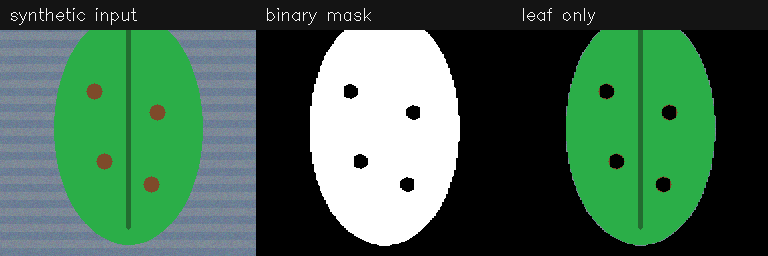

# Results

## Current evidence

There are no real greenhouse results. No verified disease dataset or trained
checkpoint is included, so segmentation Dice, classification F1, and accuracy are
intentionally unreported.

## Synthetic functional smoke test

`python scripts/run_smoke_demo.py` constructs one deterministic stylized image,
uses deterministic green-pixel segmentation and fixed synthetic classifier logits,
then exercises quality checking, mask cleanup, leaf coverage, background removal,
classification, uncertainty logic, and artifact serialization.

Machine-readable output is in [`results/smoke/summary.json`](results/smoke/summary.json).
Its `scientific_claim` field is `false`; labels are prefixed with `synthetic_`.
The confidence is a fixed software-test value and must not be interpreted as model
calibration or disease probability.

## Requirements for real results

Before this page can report performance, a run must provide verified provenance
and labels, a leakage-audited immutable split, resolved configuration, environment
manifest, trusted checkpoint, held-out metrics, uncertainty intervals, and a
limitations statement. The raw-vs-leaf-only comparison must follow
[`EXPERIMENTS.md`](EXPERIMENTS.md).
